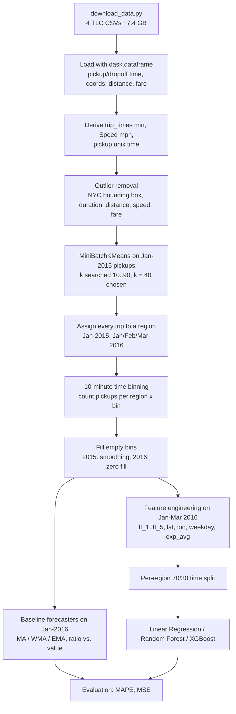

# NYC Taxi Demand Prediction — Implementation Guide

This document explains everything in this repository: the problem, the data, every processing step with its thresholds, the models, the results obtained on this machine, and how to reproduce them from a clean machine.

---

## 1. Problem statement and overview

**Goal:** given a location in New York City and a 10-minute time slot, predict the **number of yellow-taxi pickups** that will happen in that region during that slot. A ride-hailing operator can use such a forecast to pre-position drivers where demand is about to appear.

**Formulation:** time-series forecasting + regression.

1. The city is split into **40 regions** by clustering pickup coordinates (K-Means).
2. Time is split into **10-minute bins** (4,464 bins for a 31-day month).
3. For every *(region, bin)* the number of pickups is counted → 40 time series.
4. The next bin's pickups are predicted from the previous bins:
   - **Baseline forecasters** (moving average, weighted moving average, exponential moving average), either on the raw 2016 counts or on the 2016/2015 ratio.
   - **Regression models** (Linear Regression, Random Forest, XGBoost) on engineered lag + location + weekday + EMA features.
5. Models are compared with **MAPE** (computed as *mean absolute error ÷ mean actual pickups*) and **MSE**.

Data months used: **Jan 2015** (cluster fitting, ratio baselines) and **Jan–Mar 2016** (forecasting/regression).

---

## 2. Pipeline



---

## 3. Folder and file structure

```
UBER-Taxi-demand-prediction-master/
├── UBER_cab_prediction.ipynb   # The whole pipeline (EDA → cleaning → clustering → binning → models → metrics), executed with outputs
├── download_data.py            # Downloads the 4 required CSVs into data/ (resumable by size check)
├── requirements.txt            # Pinned Python dependencies that were used for the executed run
├── README.md                   # Short project overview, quick start, results
├── IMPLEMENTATION.md           # This document
├── .gitignore                  # Ignores data/, .venv, CSV/parquet/pickle artifacts, caches
├── data/                       # (git-ignored) yellow_tripdata_2015-01.csv, yellow_tripdata_2016-0{1,2,3}.csv
├── .venv/                      # (git-ignored) local virtual environment
├── New_york.gif                # Illustration used in the README
├── cluster_centers.JPG         # Static screenshot of the 40 cluster centres on a map
├── cluster_regions.JPG         # Static screenshot of the pickup points coloured by region
├── dropoff_outliers.JPG        # Static screenshot of dropoff coordinates outside NYC
└── mydask.png                  # Example dask task-graph image (what month.visualize() produces)
```

---

## 4. Tech stack (versions used for the executed run)

| Component | Version | Used for |
|---|---|---|
| Python | 3.12 (Windows 11, 64-bit) | runtime |
| dask[dataframe] | 2026.8.0 | lazy, chunked loading of the 1.7–2 GB CSVs |
| pandas | 3.1.0 | in-memory frames, datetime conversion |
| pyarrow | 26.0.0 | pandas/dask string + IO backend |
| numpy | 2.5.4 | arrays, FFT |
| scipy | 1.18.1 | Q-Q plot (`scipy.stats.probplot`) |
| scikit-learn | 1.9.1 | MiniBatchKMeans, LinearRegression, RandomForestRegressor, metrics |
| xgboost | 3.4.1 | XGBRegressor |
| matplotlib | 3.11.2 | plots |
| seaborn | 0.13.2 | box plots, KDE plots |
| folium | 0.20.0 | interactive Leaflet maps (outliers, cluster centres) |
| gpxpy | 1.6.2 | haversine distance between cluster centres |
| ipykernel / nbconvert / nbformat | 7.4.0 / 7.17.2 / 5.11.1 | executing the notebook headless |

All pins are in `requirements.txt`.

---

## 5. Dataset

### Source
NYC Taxi & Limousine Commission (TLC) yellow-taxi trip records.

* Official page: <https://www.nyc.gov/site/tlc/about/tlc-trip-record-data.page>
* **Important:** the official site now serves these months only as **parquet files that no longer contain latitude/longitude** (they were re-issued with `PULocationID`/`DOLocationID` zone ids only). This pipeline needs raw coordinates for clustering, so `download_data.py` fetches the **original TLC CSV files** (with coordinates) from a public mirror:
  `https://storage.googleapis.com/anaconda-public-data/nyc-taxi/csv/<year>/yellow_tripdata_<yyyy-mm>.csv`
* NYC Open Data also hosts these years with coordinates (`2yzn-sicd` for 2015, `uacg-pexx` for 2016), but its API was far too slow for month-sized extracts (~100 rows/s with a date filter), so it is not used.

### Files used (full months, no sampling)

| File | Size (bytes) | Rows | Role |
|---|---|---|---|
| `yellow_tripdata_2015-01.csv` | 1,985,964,692 | 12,748,986 | EDA, outlier thresholds, K-Means fitting, ratio baselines |
| `yellow_tripdata_2016-01.csv` | 1,708,674,492 | 10,906,858 | forecasting / regression |
| `yellow_tripdata_2016-02.csv` | 1,783,554,554 | 11,382,049 | forecasting / regression |
| `yellow_tripdata_2016-03.csv` | 1,914,669,757 | 12,210,952 | forecasting / regression |

Total ≈ 7.4 GB on disk.

### Columns (19 per file)
`VendorID, tpep_pickup_datetime, tpep_dropoff_datetime, passenger_count, trip_distance, pickup_longitude, pickup_latitude, RateCodeID (2016: RatecodeID), store_and_fwd_flag, dropoff_longitude, dropoff_latitude, payment_type, fare_amount, extra, mta_tax, tip_amount, tolls_amount, improvement_surcharge, total_amount`

Columns actually used: `tpep_pickup_datetime, tpep_dropoff_datetime, passenger_count, trip_distance, pickup_longitude, pickup_latitude, dropoff_longitude, dropoff_latitude, total_amount`.

### Download

```bash
python download_data.py                                  # all 4 files
python download_data.py yellow_tripdata_2016-01.csv      # a single file
```
The script streams each file to `data/<name>.part`, verifies the exact byte size, then renames it. Already-complete files are skipped.

---

## 6. Data cleaning (Jan 2015 analysed, same rules applied to every month)

Derived columns (function `return_with_trip_times`):
* `trip_times` = (dropoff − pickup) in **minutes**
* `pickup_times` = pickup as a unix timestamp (see §8 for the timezone detail)
* `Speed` = 60 × `trip_distance` / `trip_times` (**miles per hour**)

Final filters applied by `remove_outliers` (a row must pass **all** of them):

| # | Rule | Threshold | Why |
|---|---|---|---|
| 1 | Pickup **and** dropoff inside NYC bounding box | lat 40.5774 – 40.9176, lon −74.15 – −73.7004 | Box from Flickr's NYC place bounds; points outside are GPS errors (e.g. 0,0) or trips leaving the city. The folium maps of the first outliers show points far outside NYC. |
| 2 | Trip duration | 0 < `trip_times` < 720 min | TLC rule: max 12 h of driving in 24 h. Percentile scan (Jan 2015): 0th = −1,211 min, 99th = 46.75 min, max = 548,556 min. |
| 3 | Trip distance | 0 < `trip_distance` < 23 miles | 99.9th percentile = 22.57 miles; max = 258.9 miles. |
| 4 | Speed | 0 < `Speed` < 45.31 mph | 99.9th percentile of speed = 45.31 mph; max = 192,857,143 mph (impossible). (The printed "speed outliers" count in `remove_outliers` uses ≤ 65 mph only for reporting; the actual filter is 45.31.) |
| 5 | Fare | 0 < `total_amount` < 1000 USD | 99.9th percentile = 88.28 USD but max = 3,950,611.6 USD; the sorted-fare plots show the sharp jump near 1000. ≤ 0 is invalid. |

Supporting EDA in the notebook: box plots, 0–100 / 90–100 / 99.0–99.9 percentile scans for duration, speed, distance and fare; KDE of trip time and log trip time; Q-Q plot showing log(trip time) is approximately normal (trip time is log-normal); average speed after the speed filter = 12.45 mph → a cab covers ≈ 2 miles per 10-minute bin, which motivates the "neighbouring clusters within 2 miles" criterion used for choosing k.

Results on this run (printed by `remove_outliers`):

| Month | Records | Outside NYC box | Duration outliers | Distance outliers | Speed outliers (>65 / <0, report only) | Fare outliers | **Total removed** | Kept |
|---|---|---|---|---|---|---|---|---|
| Jan 2015 | 12,748,986 | 293,919 | 23,889 | 92,597 | 24,473 | 5,275 | **377,910** | 97.04% |
| Jan 2016 | 10,906,858 | 214,677 | 27,190 | 79,742 | 21,047 | 4,991 | **297,784** | 97.27% |
| Feb 2016 | 11,382,049 | 223,161 | 27,670 | 81,902 | 22,437 | 5,476 | **308,177** | 97.29% |
| Mar 2016 | 12,210,952 | 232,444 | 30,868 | 87,318 | 23,889 | 5,859 | **324,635** | 97.34% |

(Category counts overlap; "Total removed" is after applying all filters together.)

---

## 7. Clustering into regions

* Algorithm: `sklearn.cluster.MiniBatchKMeans(batch_size=10000)` on cleaned Jan-2015 `(pickup_latitude, pickup_longitude)`.
* **Choice of k:** k ∈ {10, 20, …, 90} is tried (`random_state=42`). For each k the haversine distance (gpxpy, converted to miles) between every pair of centres is computed, and the notebook prints
  * the average number of other centres within 2 miles (should be reasonably high — a driver can reach them in one 10-min bin),
  * the average number further than 2 miles,
  * the minimum inter-centre distance (should not be tiny, otherwise two regions are effectively the same place).
* Output of the search on this run (full 12.37M cleaned Jan-2015 pickups):

  | k | avg centres within 2 mi | avg centres beyond 2 mi | min inter-centre distance (mi) |
  |---|---|---|---|
  | 10 | 3 | 7 | 0.959 |
  | 20 | 5 | 14 | 0.639 |
  | 30 | 9 | 21 | 0.480 |
  | **40** | **11** | **29** | **0.477** |
  | 50 | 14 | 36 | 0.373 |
  | 60 | 16 | 44 | 0.335 |
  | 70 | 22 | 48 | 0.236 |
  | 80 | 24 | 56 | 0.212 |
  | 90 | 27 | 63 | 0.196 |

* **k = 40** is chosen as the trade-off: it keeps ~11 neighbouring regions within 2 miles while the minimum inter-centre distance stays ≈ 0.48 mi; from k = 50 on, regions start to sit closer than 0.4 mi. The final model is refit with `n_clusters=40, random_state=0` (full data, no sampling).
* The 40 centres are drawn on a folium map (tiles `CartoDB positron`) and the first 100,000 pickups are scatter-plotted coloured by region.
* The same fitted model labels every trip of Jan/Feb/Mar 2016 (`kmeans.predict`).

---

## 8. Time binning

* Each trip gets `pickup_bins = int((pickup_unix − month_start_unix) / 600) + 33` (10-minute bins).
* Month starts are hard-coded unix times for 00:00 UTC on the 1st (e.g. 1420070400 = 2015-01-01).
* The `+33` offset exists because the pipeline first converted timestamps with `time.mktime()`, which interprets the naive time in the **machine's local timezone**; the binning constants were derived on an IST (UTC+5:30) machine, and 5.5 h = 19,800 s = 33 bins. The current notebook replaces the per-row `strptime`/`mktime` with a vectorised pandas conversion that subtracts exactly 19,800 s, so bin 0 = 00:00–00:10 local NYC clock time on the 1st **regardless of the timezone of the machine running it**.
* Grouping by `(pickup_cluster, pickup_bins)` and counting gives pickups per region per bin. Bins per month: Jan/Mar = 4,464, Feb 2016 = 4,176.

### Filling empty bins
Some (region, bin) pairs have no pickups and therefore no row after grouping.
* **Jan 2015 (`smoothing`)**: a gap is filled by spreading the neighbouring known values evenly: `x _ _ y → ceil((x+y)/4)` ×4 (also the left neighbour is overwritten), leading gaps `_ _ x → ceil(x/3)` ×3, trailing gaps `x _ _ → ceil(x/3)` ×3. Used for 2015 because it is "history" (looking at the right neighbour is acceptable).
* **2016 (`fill_missing`)**: gaps are filled with **0** — smoothing would leak future values into the data we forecast.

### Fourier analysis
`np.fft.fft` of the first 4,460 Jan-2016 bins of region 0: apart from the zero-frequency (mean) term, the largest peak is at ≈ 0.007 cycles/bin (= 1/144, one day) with a second peak at ≈ 0.014 (12 h), confirming daily seasonality.

---

## 9. Baseline forecasting models (Jan 2016, all 40 regions concatenated)

`R_t = P2016_t / P2015_t` (ratio), `P_t` = 2016 pickups. Each model predicts bin t from bins < t.

| Function | Model | Hyper-parameter |
|---|---|---|
| `MA_R_Predictions` | Moving average of ratios, prediction = P2015_t × R̂_t | window n = 3 |
| `MA_P_Predictions` | Moving average of 2016 values | window n = 1 (i.e. P̂_t = P_{t−1}) |
| `WA_R_Predictions` | Weighted MA of ratios (weights n…1) | n = 5 |
| `WA_P_Predictions` | Weighted MA of 2016 values | n = 2 → P̂_t = (2P_{t−1}+P_{t−2})/3 |
| `EA_R1_Predictions` | Exponential MA of ratios: R̂_t = α R̂_{t−1} + (1−α) R_{t−1} | α = 0.6 |
| `EA_P1_Predictions` | Exponential MA of 2016 values: P̂_t = α P̂_{t−1} + (1−α) P_{t−1} | α = 0.3 |

Window sizes / α are fixed values chosen by manual tuning. Errors: **MAPE** = mean(|error|) / mean(actual); **MSE** = mean(error²).

---

## 10. Feature engineering (regression models, Jan–Mar 2016)

For each region, the 2016 series is Jan (4,464) + Feb (4,176) + Mar (4,464) = 13,104 bins. The first 5 bins are used only as history, giving **13,099 samples per region × 40 = 523,960 samples**.

| Feature | Meaning |
|---|---|
| `ft_5, ft_4, ft_3, ft_2, ft_1` | pickups in the previous 5 bins (ft_1 = most recent) |
| `lat`, `lon` | the region's cluster-centre coordinates |
| `weekday` | day of week of the bin, `((bin // 144) % 7 + 4) % 7` (Sunday = 0) |
| `exp_avg` | exponential moving average with α = 0.3 (best baseline) |

Target: pickups in the current bin.

**Split:** per region, time-ordered: first **9,169** bins (70%) → train, remaining **3,930** → test. Train = 366,760 rows, test = 157,200 rows, 9 features.

---

## 11. Regression models

| Model | Hyper-parameters |
|---|---|
| `LinearRegression()` | defaults |
| `RandomForestRegressor` | `max_features='sqrt', min_samples_leaf=4, min_samples_split=3, n_estimators=40, n_jobs=-1` (no fixed seed) |
| `xgb.XGBRegressor` | `learning_rate=0.1, n_estimators=1000, max_depth=3, min_child_weight=3, gamma=0, subsample=0.8, colsample_bytree=0.8, reg_alpha=200, reg_lambda=200, n_jobs=4` |

Predictions are rounded to integers. The notebook prints Random-Forest feature importances and XGBoost split counts (`get_booster().get_score(importance_type='weight')`).

---

## 12. Metrics and results (actual run on this machine)

All numbers below come from the executed notebook in this repo (full months, no sampling). **MAPE** = mean |actual − predicted| ÷ mean(actual), so 0.127 ≈ predictions are off by 12.7% of average demand.

### Baseline forecasters (Jan 2016, 40 regions × 4,464 bins)

| Model | MAPE | MSE |
|---|---|---|
| Moving Average — ratios (n=3) | 0.1850 | 425.02 |
| Moving Average — 2016 values (n=1) | 0.1423 | 174.26 |
| Weighted MA — ratios (n=5) | 0.1812 | 402.02 |
| Weighted MA — 2016 values (n=2) | 0.1350 | 162.36 |
| Exponential MA — ratios (α=0.6) | 0.1804 | 398.02 |
| **Exponential MA — 2016 values (α=0.3)** | **0.1347** | **159.91** |

Forecasting from the 2016 values beats the ratio-to-2015 approach in every case; the exponential MA on 2016 values is the best baseline and is reused as the `exp_avg` feature.

### Regression models (Jan–Mar 2016, per-region 70/30 time split)

| Model | Train MAPE | Test MAPE |
|---|---|---|
| Baseline (previous bin, `ft_1`) | 0.1398 | 0.1367 |
| Exponential average (`exp_avg`) | 0.1327 | 0.1295 |
| Linear Regression | 0.1329 | 0.1292 |
| Random Forest | 0.0915 | **0.1269** |
| XGBoost | 0.1292 | **0.1269** |

Random Forest (0.12687) and XGBoost (0.12686) tie for the best test MAPE, about 7% (relative) better than the naive previous-bin baseline. The Random Forest's much lower train MAPE shows it overfits; XGBoost has almost no train/test gap.

Feature importance:
* Random Forest (`feature_importances_`): exp_avg 0.383, ft_1 0.256, ft_3 0.159, ft_2 0.122, ft_4 0.058, ft_5 0.013, lon 0.004, lat 0.002, weekday 0.002. Recent demand dominates.
* XGBoost split counts (`weight`): ft_1 1038, ft_5 1003, ft_2 936, ft_3 852, exp_avg 809, lon 784, ft_4 667, lat 633, weekday 265.

Other values from the run: average cab speed after cleaning = 12.45 mph; cleaned Jan-2015 pickups used for clustering = 12,371,076; regression design = 366,760 train rows and 157,200 test rows × 9 features.

---

## 13. Setup from a clean machine

Requirements: Python 3.11/3.12, ~8 GB free disk for data, **16 GB RAM** recommended (the full-month frames peak at several GB; see §15), internet access.

### Windows (PowerShell)
```powershell
cd UBER-Taxi-demand-prediction-master
py -3.12 -m venv .venv
.\.venv\Scripts\python.exe -m pip install --upgrade pip
.\.venv\Scripts\python.exe -m pip install -r requirements.txt
.\.venv\Scripts\python.exe -m ipykernel install --sys-prefix --name uber-taxi --display-name "Python (uber-taxi .venv)"
.\.venv\Scripts\python.exe download_data.py
```

### Linux / macOS (bash)
```bash
cd UBER-Taxi-demand-prediction-master
python3.12 -m venv .venv
.venv/bin/python -m pip install --upgrade pip
.venv/bin/python -m pip install -r requirements.txt
.venv/bin/python -m ipykernel install --sys-prefix --name uber-taxi --display-name "Python (uber-taxi .venv)"
.venv/bin/python download_data.py
```

Optional: install the Graphviz system package (`winget install graphviz` / `apt install graphviz` / `brew install graphviz`) **and** `pip install graphviz` to render the two dask task-graph cells; without them those cells just print "Graph visualisation skipped".

---

## 14. How to run

Interactive:
```bash
.venv/bin/python -m jupyter lab        # or: .\.venv\Scripts\python.exe -m jupyter notebook   (pip install jupyterlab/notebook first)
```
Open `UBER_cab_prediction.ipynb`, select the kernel **Python (uber-taxi .venv)**, *Run All*.

Headless (what was used to produce the committed outputs):
```bash
# Windows
.\.venv\Scripts\python.exe -m nbconvert --to notebook --execute --inplace --ExecutePreprocessor.timeout=-1 UBER_cab_prediction.ipynb
# Linux / macOS
.venv/bin/python -m nbconvert --to notebook --execute --inplace --ExecutePreprocessor.timeout=-1 UBER_cab_prediction.ipynb
```
Run time on this machine (14 logical cores, 16 GB RAM, another heavy process running in parallel): 2,293 s (about 38 min) for the full headless execution.

The notebook reads data from `data/` relative to the notebook, so run it from the project root.

---

## 15. Troubleshooting — problems hit while making this run, and the fixes

| Problem | Cause | Fix applied |
|---|---|---|
| Official TLC parquet for 2015/2016 has no `pickup_latitude/longitude` | TLC re-issued historical data with zone ids only | Download original CSVs from the public mirror (`download_data.py`) |
| `s3://nyc-tlc/...csv` → 403 | old bucket is closed | same as above |
| NYC Open Data API too slow for monthly extracts | server-side scan on date filter | not used |
| `ValueError: Mismatched dtypes found in pd.read_csv` (`tolls_amount` float vs int) | dask infers dtypes from the first block | `dd.read_csv(..., assume_missing=True)` |
| `ModuleNotFoundError: No module named 'dask'` during nbconvert | `jupyter nbconvert` resolved to a global Jupyter/kernel (`python3`) instead of the venv | register the venv kernel `uber-taxi` (notebook metadata points to it) and call `python -m nbconvert` with the venv interpreter |
| `matplotlib.use('nbagg')` gives interactive JS widgets, no saved images in headless runs | backend choice | replaced with `%matplotlib inline` |
| folium `tiles='Stamen Toner'` fails | Stamen tiles retired (moved to Stadia, needs key) | `tiles='CartoDB positron'` |
| `FacetGrid(size=6)` TypeError | seaborn renamed `size` → `height` | `height=6` |
| `NameError: scipy` in the Q-Q plot cell | `scipy` was never imported | `import scipy.stats` added to the imports cell |
| `x_model.booster()` AttributeError | XGBoost API change | `x_model.get_booster()` |
| `nthread` deprecated in XGBRegressor | XGBoost API change | `n_jobs=4` |
| Row-wise `strptime` + `time.mktime` on 12M rows is slow and depends on machine timezone | per-row Python + local-time conversion | vectorised `pd.to_datetime` − 19,800 s (§8) |
| `month.visualize()` fails | Graphviz binary not installed | wrapped in try/except; optional install (§13) |
| Final MAPE table mislabelled XGBoost as "Linear Regression" and omitted one model | print-statement indices | now prints all five models with correct labels |
| First `pip install` hung with no output | network stall to PyPI on this machine | killed and re-ran with `--timeout 60`; it completed in a few minutes |
| High memory use / paging (kernel reached ~8.1 GB private memory on this run) | 4 full months held in memory at once | close other heavy programs; 16 GB RAM recommended |

---

## 16. Limitations and next steps

Known limitations of the current logic (kept as-is so the results stay comparable to the notebook's design):
* **February misalignment:** `fill_missing` always produces 4,464 bins per region, but February 2016 has 4,176; when `regions_cum` is built it slices Feb with a stride of 4,176. Region *i*'s February segment is therefore offset by 288 × *i* positions: it starts with the (empty) tail of earlier regions and, for higher region numbers, contains another region's February counts. Fixing it means passing the month's bin count into `fill_missing`.
* **Weekday offset:** the code assumes 1 Jan 2016 was a Thursday (`+4`); it was a Friday. The `weekday` feature is therefore shifted by one day (consistently, so trees can still use it).
* **Out-of-month trips:** `fill_missing`/`smoothing` assume every bin is in 0..4,463. Checked on this data: Feb 2016 has no pickups outside February, and every Jan-2015 region has fewer than 4,464 distinct bins, so this does not occur here, but other months could break the alignment.
* **Baselines** are compared on Jan only, and the ratio models need Jan 2015 for every forecast month.
* **MAPE** here is MAE / mean(actual) (a weighted MAPE), not the per-point MAPE.
* Random Forest has no fixed seed → small run-to-run variation.
* No hyper-parameter search is run in the notebook; the RF/XGB settings are fixed values.

Next steps:
* Fix the Feb bin count and weekday offset, then re-evaluate.
* Add more history features (same bin last day / last week), holiday and weather features.
* Use Jan–Mar 2015 for ratio features in all three months.
* Proper time-series cross-validation and hyper-parameter search.
* Re-express the pipeline with TLC zone ids so newer data (parquet, no coordinates) can be used.
