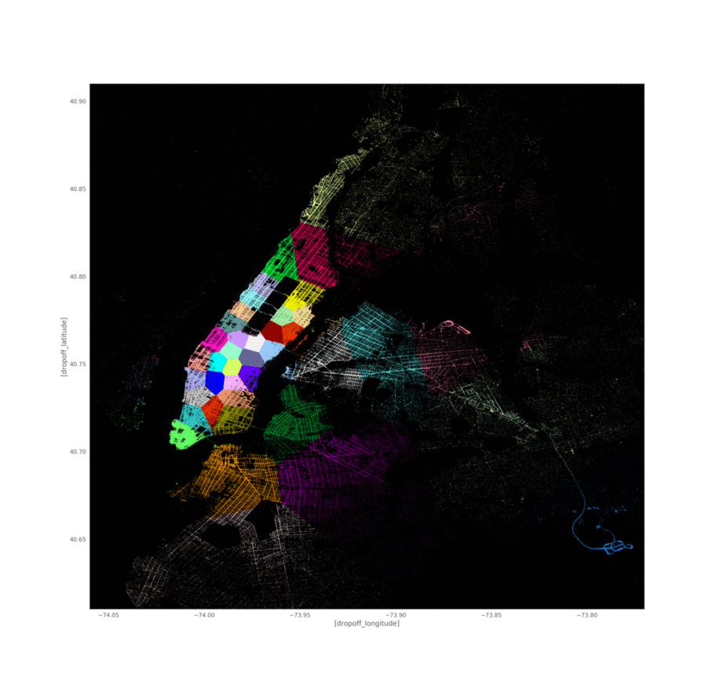

# NYC Taxi Demand Prediction

Forecasts the number of taxi pickups in each region of New York City for the next 10 minutes, using NYC TLC yellow-taxi trip records.



## What it does

1. **Cleans** full months of trip data (12.7M rows for Jan 2015, 10.9M–12.2M for each 2016 month). It removes coordinates outside NYC, impossible durations, distances, speeds and fares, which drops about 2.7–3% of rows.
2. **Clusters** pickup coordinates into **40 regions** with MiniBatchKMeans. k is chosen by checking inter-region distances, so a cab can reach the neighbouring regions within one 10-minute slot.
3. **Bins time** into 10-minute slots and counts pickups per (region, slot).
4. **Forecasts** with baseline models (moving, weighted and exponential averages) and with regression models (Linear Regression, Random Forest and XGBoost) built on lag features, region location, weekday and an exponential-average feature.
5. **Evaluates** with MAPE (mean absolute error ÷ mean demand) and MSE.

See [IMPLEMENTATION.md](IMPLEMENTATION.md) for every step, threshold, hyper-parameter and design decision.

## Results (full data, actual run)

Regression models, Jan–Mar 2016, per-region 70/30 time split:

| Model | Train MAPE | Test MAPE |
|---|---|---|
| Baseline (previous 10-min slot) | 0.1398 | 0.1367 |
| Exponential moving average | 0.1327 | 0.1295 |
| Linear Regression | 0.1329 | 0.1292 |
| Random Forest | 0.0915 | **0.1269** |
| XGBoost | 0.1292 | **0.1269** |

Best baseline forecaster (Jan 2016): exponential moving average of 2016 values, MAPE 0.1347, MSE 159.9.

Known limitations (February bin alignment, weekday offset, unseeded Random Forest) are documented in [IMPLEMENTATION.md §16](IMPLEMENTATION.md#16-limitations-and-next-steps).

## Dataset

NYC TLC yellow-taxi trip records ([TLC trip record data](https://www.nyc.gov/site/tlc/about/tlc-trip-record-data.page)). The pipeline needs raw pickup/dropoff **latitude/longitude**. The official site now only serves these months as parquet files with zone IDs, so `download_data.py` fetches the original CSVs from a public mirror (`storage.googleapis.com/anaconda-public-data/nyc-taxi/csv/`):

| File | Size | Rows |
|---|---|---|
| yellow_tripdata_2015-01.csv | 1.99 GB | 12,748,986 |
| yellow_tripdata_2016-01.csv | 1.71 GB | 10,906,858 |
| yellow_tripdata_2016-02.csv | 1.78 GB | 11,382,049 |
| yellow_tripdata_2016-03.csv | 1.91 GB | 12,210,952 |

Full months are used, with no sampling. The files go to `data/`, which is git-ignored.

## Setup

Requires Python 3.11 or 3.12, about 8 GB of free disk and 16 GB of RAM (recommended).

**Windows (PowerShell)**
```powershell
py -3.12 -m venv .venv
.\.venv\Scripts\python.exe -m pip install -r requirements.txt
.\.venv\Scripts\python.exe -m ipykernel install --sys-prefix --name uber-taxi --display-name "Python (uber-taxi .venv)"
.\.venv\Scripts\python.exe download_data.py
```

**Linux / macOS**
```bash
python3.12 -m venv .venv
.venv/bin/python -m pip install -r requirements.txt
.venv/bin/python -m ipykernel install --sys-prefix --name uber-taxi --display-name "Python (uber-taxi .venv)"
.venv/bin/python download_data.py
```

## Run

Headless, writing outputs into the notebook (about 38 min on the full data on a 14-thread, 16 GB machine):
```bash
.venv/bin/python -m nbconvert --to notebook --execute --inplace --ExecutePreprocessor.timeout=-1 UBER_cab_prediction.ipynb
# Windows: .\.venv\Scripts\python.exe -m nbconvert --to notebook --execute --inplace --ExecutePreprocessor.timeout=-1 UBER_cab_prediction.ipynb
```
You can also open the notebook in Jupyter and select the **Python (uber-taxi .venv)** kernel. Run it from the project root, because it reads from `data/`.

The two dask task-graph cells need the optional Graphviz system binary plus `pip install graphviz`. Without them, those cells print a skip message.

## Project structure

| Path | Purpose |
|---|---|
| `UBER_cab_prediction.ipynb` | Full pipeline with executed outputs |
| `download_data.py` | Downloads the 4 CSVs into `data/` |
| `requirements.txt` | Pinned dependencies |
| `IMPLEMENTATION.md` | Detailed design and implementation guide |
| `*.JPG`, `*.png`, `*.gif` | Illustrations (maps, clusters, task graph) |
